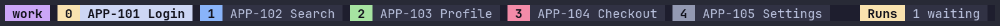

# dot-tmux

A tmux workspace for Claude Code, Codex, and opencode: agent status, a shared
session picker, conversation logs, usage popups, and terminal layout restore.

[Preview](#preview) · [Setup](#setup) · [Shortcuts](#shortcuts) · [Session history](#session-history-and-restore) · [Reference](docs/reference.md)

## Preview

Open the shared picker with `prefix a` or `prefix r` to see running agents,
delivery phases, and sessions waiting for you. Type a row number to jump to it.


See [picker columns](#picker-columns) for where each value comes from, and
[picker status meanings](#picker-status-meanings) for the `STATE` labels.

Images throughout these docs show tmux views with sample task names and values.
Popup borders, sizes, labels, and spacing come from the running interfaces.
See [capture notes](docs/images/README.md) for their sources.

The reference also shows [conversation logs](docs/reference.md#conversation-logs),
[tab tokens and cost](docs/reference.md#tab-tokens-and-cost),
[account usage](docs/reference.md#account-usage), and
[system usage](docs/reference.md#system-usage).

## Setup

This setup targets macOS. It needs tmux, Git, `jq`, Python 3, and `uv`.
Install [agent-skills](https://github.com/osvald0/agent-skills)' global tools for
the session picker and registry. Add `~/.local/bin` to your `PATH`.
Lazygit is needed for `prefix G`; Ghostty is needed for `prefix C-e`.
The URL picker (`prefix u`) needs `fzf` and `fzf-tmux` on your `PATH`.
Setup downloads plugins but does not install these tools or the agent CLIs.

From this checkout:

```sh
./setup.sh
```

Setup links the config and helpers, installs the tmux plugins, and connects the
three agents' status hooks. It preserves unrelated hooks and settings and backs
up regular config files before replacing them. Keep this checkout: the installed
files are symlinks to it.

Start a named workspace:

```sh
tmux new-session -s work
```

To reload the config in an existing server:

```sh
tmux source-file ~/.tmux.conf
```

Restart existing agent sessions to load changed hooks. Codex may ask you to trust them.
See [installation and updates](docs/reference.md#installation-and-updates) for
installed paths and backups, and [agent support](docs/reference.md#agent-support)
for differences between providers.

## Shortcuts

The default prefix is `Ctrl-b`. Press and release it, then press the listed key.
For example, `prefix a` means `Ctrl-b`, then `a`. This config does not change an
existing server's custom prefix.

| Keys | Action |
| --- | --- |
| `prefix a` or `prefix r` | Open the shared agent and run picker |
| `prefix Space` | Jump to another waiting agent, then a finished one |
| `prefix s` | Browse tmux sessions, windows, and panes |
| `prefix L` | Return to the last tmux session |
| `prefix e` | Toggle the current conversation's logs in a split |
| `prefix W` | Open logs in a new tmux window |
| `prefix C-e` | Toggle logs in a separate Ghostty window |
| `prefix T` | Show the current tab's token usage and cost |
| `prefix v` | Show Claude and Codex account usage |
| `prefix S` | Show CPU, memory, disk, and agent resource usage |
| `prefix G` | Open Lazygit |
| `prefix u` | Pick and open a URL from the current pane's visible text |
| `prefix [` | Enter copy mode to select text or browse scrollback |
| `prefix y` / `prefix Y` | Copy the current line / pane's working directory |
| `prefix d` | Detach while leaving sessions and agents running |
| `prefix R` | Reload the tmux config through tmux-sensible |
| `prefix c` | Create a window in the current directory |
| `prefix ,` | Rename the current window, for example `APP-101 Login` |
| `prefix \|` / `prefix -` | Split horizontally / vertically |
| `prefix h/j/k/l` | Move between panes |
| `Option+Shift+Arrow` | Resize the current pane |
| `prefix O` | Sort tabs by name (also automatic) |
| `prefix Ctrl-s` / `prefix Ctrl-r` | Save / restore the terminal workspace |

In the agent picker, type a row number to jump, `o` followed by a number to open
its PR, or `q` to close. Both picker shortcuts open the same view.
The picker refreshes every 15 seconds when you are not entering a row number.

After detaching, reconnect with `tmux attach -t work` (use your session name).
See [navigation, names, and clipboard](docs/reference.md#navigation-names-and-clipboard)
for tree controls, sorting, and copying text.

`prefix s` opens the tmux tree. Expand a session to browse its windows and panes;
the preview below the list shows the selected workspace.


## Reading agent status

The tab's number block and the dots in `prefix s` show the agent's activity:



Tabs can have descriptive task names. Use `prefix ,` to rename a window; its
activity color still follows the agent in that window.
In a split window, the tab and window-level dot reflect the active pane;
expanded pane rows show each agent's own state.

| Color | Meaning |
| --- | --- |
| Blue | Working |
| Yellow | Waiting for input or permission |
| Green | Turn finished; returns to ready when focused |
| Red | Turn failed |
| Gray | Ready, or no agent in the pane |

The right side of the status bar shows waiting delivery runs and resource usage
at 80% or above. The run count excludes sessions without a delivery run.
Claude and opencode can notify you when they need attention; Codex handles its
own notifications. See [notification behavior](docs/reference.md#notifications).

### Picker columns

The picker combines agent-skills' session registry with live tmux information.
Agent hooks record conversation activity. The delivery workflow writes task
metadata with `runs set`; a conversation can appear without a delivery run.

| Column | Content and source |
| --- | --- |
| `#` | Row number assigned by the picker for jumping or opening a PR; it can change when the list is reordered |
| `ID` | For a delivery run, the ID supplied to `runs set`, often a task number. For a session, its saved title, refreshed from the tmux window name or pane title when automatic naming is enabled; falls back to the conversation ID and displays up to 40 characters |
| `STATE` | Session activity reported by agent hooks, or the run state recorded with `runs set --state`. A linked session waiting or reporting an error overrides an unfinished run's displayed state; inactivity can produce `quiet` or `lost` |
| `WHERE` | Live tmux session name and window index, such as `work:2`; falls back to a saved pane ID when its location cannot be resolved, or `-` when disconnected |
| `PHASE` | Workflow stage written with `runs set --phase`, such as `Review` or `Verify`. A GitHub check can replace it with `MERGED` or `CLOSED` when the linked PR finishes |
| `PR` | URL saved with `runs set --pr`, displayed as its PR number when it matches a GitHub pull request URL; `-` if none is saved |
| `NOW` | For a running delivery run, the last tool activity and agent role recorded by the Claude heartbeat hook. Shows `thinking` after that tool finishes, or `-` without activity data |
| `FOR` | Elapsed time calculated from the tool's start while busy, the latest update while running without an active tool, or the state change otherwise. This is not total conversation duration; `-` means a session has no known state timestamp |
| `NOTE` | Short message written with `runs set --note`, usually what needs attention or the next step |

`PHASE`, `PR`, and `NOTE` belong to delivery runs, so ordinary session rows leave
them blank or show `-`. `NOW` needs heartbeat data; it does not infer activity
from the conversation text. The run ID, phase, and note are supplied by the
workflow or a manual command, not fetched automatically from a ticket tracker.

For an existing run, a metadata update looks like:

```sh
runs set APP-101 --phase Review --note "Review login changes"
```

See [hooks and registry integration](docs/reference.md#hooks-and-registry-integration)
for how session events reach the registry, and the
[picker implementation](https://github.com/osvald0/agent-skills/tree/main/global/lib/runs_cli)
for its data and rendering logic.

### Picker status meanings

The `STATE` column in `prefix a` / `prefix r` describes either an agent session
or its linked delivery run:

| Status | Meaning |
| --- | --- |
| `WAITING` | Needs your input, permission, or review |
| `running` | The agent is working, or the delivery run is still in progress |
| `done` | The agent's turn finished, or the delivery run was marked complete |
| `failed` | The agent reported an error, or the delivery run was marked failed |
| `idle` | The session is ready for another prompt |
| `quiet` | A running delivery run has no active work reported and no activity update for over 10 minutes |
| `lost` | The same as `quiet`, but for over an hour and with no connected pane |
| `stopped` | The delivery run was marked stopped |

Run progress and agent activity are tracked separately. A run can remain
`running` after its agent finishes a turn, while that tab turns green.
`quiet` and `lost` describe stale activity reports, not confirmed failures.
Use `runs --all` to include finished runs and disconnected conversations.

## Session history and restore

These save different parts of the workspace:

| Owner | What it saves |
| --- | --- |
| agent-skills' SQLite registry | Conversation identity, status, project, and delivery-run links |
| Claude, Codex, or opencode | Conversation transcripts |
| tmux-resurrect | Sessions, windows, panes, directories, layouts, and resume commands |

Use `runs --all` for saved conversations, including closed panes. `runs go`
prints the appropriate resume command when a conversation has no open pane.

Terminal layouts autosave every 15 minutes. Restoration is manual with
`prefix Ctrl-r`; `prefix Ctrl-s` saves immediately. Pane contents are not saved.
See [restore troubleshooting](docs/reference.md#restore-troubleshooting) if a
layout or conversation is missing.

## Reference and development

[Reference](docs/reference.md) covers log controls, usage displays, account
connection, hooks, notifications, and troubleshooting.

The runtime configuration is in [tmux.conf](tmux.conf), helpers are in [bin/](bin/),
and provider integrations are in [agents/](agents/).
See [checks](docs/reference.md#checks) for the isolated test commands.
