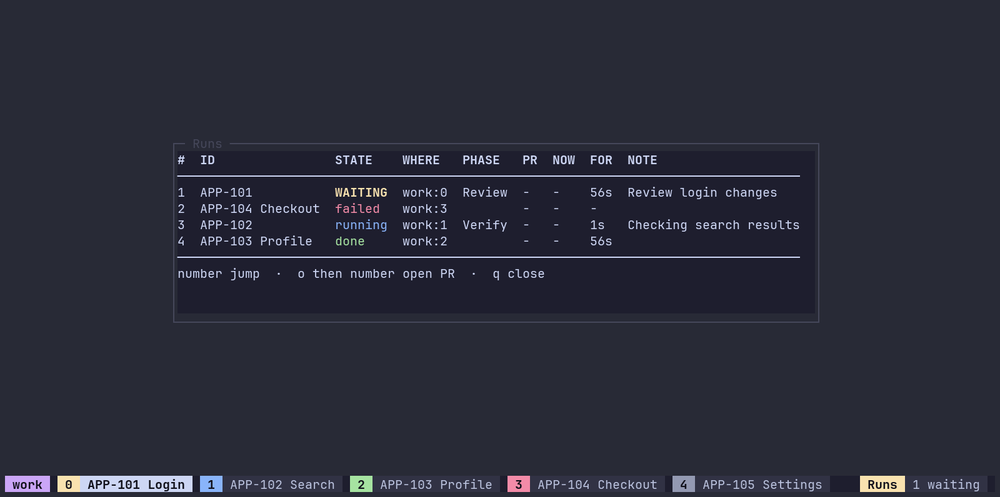
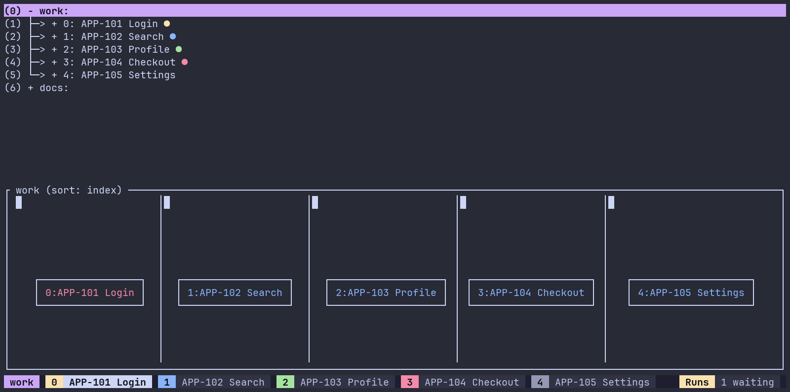

# dot-tmux

A tmux workspace for Claude Code, Codex, and opencode: agent status, a shared
session picker, conversation logs, usage popups, and terminal layout restore.

[Preview](#preview) · [Setup](#setup) · [Shortcuts](#shortcuts) · [Session history](#session-history-and-restore) · [Reference](docs/reference.md)

## Preview

Open the shared picker with `prefix a` or `prefix r` to see running agents,
delivery phases, and sessions waiting for you. Type a row number to jump to it.



Images throughout these docs show tmux views with sample task names and values.
Popup borders, sizes, labels, and spacing come from the running interfaces.
See [capture notes](docs/images/README.md) for their sources.

The reference also shows [conversation logs](docs/reference.md#conversation-logs),
[tab tokens and cost](docs/reference.md#tab-tokens-and-cost),
[account usage](docs/reference.md#account-usage), and
[system usage](docs/reference.md#system-usage).

## Setup

This setup targets macOS. It needs tmux, Git, `jq`, Python 3, and `uv`.
Install [agent-skills](https://github.com/osvald0/agent-skills)' global tools for
the session picker and registry. Add `~/.local/bin` to your `PATH`.
Lazygit is needed for `prefix G`; Ghostty is needed for `prefix C-e`.

From this checkout:

```sh
./setup.sh
```

Setup links the config and helpers, installs the tmux plugins, and connects the
three agents' status hooks. It preserves unrelated hooks and settings and backs
up regular config files before replacing them. Keep this checkout: the installed
files are symlinks to it.

Start tmux, or reload the config in an existing server:

```sh
tmux source-file ~/.tmux.conf
```

Restart existing agent sessions to load changed hooks. Codex may ask you to trust them.

## Shortcuts

Press your tmux prefix before the keys labeled `prefix`.

| Keys | Action |
| --- | --- |
| `prefix a` or `prefix r` | Open the shared agent and run picker |
| `prefix Space` | Jump to another waiting agent, then a finished one |
| `prefix s` | Browse tmux sessions, windows, and panes |
| `prefix L` | Return to the last tmux session |
| `prefix e` | Toggle the current conversation's logs in a split |
| `prefix W` | Open logs in a new tmux window |
| `prefix C-e` | Toggle logs in a separate Ghostty window |
| `prefix T` | Show the current tab's token usage and cost |
| `prefix v` | Show Claude and Codex account usage |
| `prefix S` | Show CPU, memory, disk, and agent resource usage |
| `prefix G` | Open Lazygit |
| `prefix c` | Create a window in the current directory |
| `prefix ,` | Rename the current window, for example `APP-101 Login` |
| `prefix \|` / `prefix -` | Split horizontally / vertically |
| `prefix h/j/k/l` | Move between panes |
| `Option+Shift+Arrow` | Resize the current pane |
| `prefix O` | Sort tabs by name (also automatic) |
| `prefix Ctrl-s` / `prefix Ctrl-r` | Save / restore the terminal workspace |

In the agent picker, type a row number to jump, `o` followed by a number to open
its PR, or `q` to close. Both picker shortcuts open the same view.

`prefix s` opens the tmux tree. Expand a session to browse its windows and panes;
the preview below the list shows the selected workspace.



## Reading agent status

The tab's number block and the dots in `prefix s` show the agent's activity:


Tabs can have descriptive task names. Use `prefix ,` to rename a window; its
activity color still follows the agent in that window.

| Color | Meaning |
| --- | --- |
| Blue | Working |
| Yellow | Waiting for input or permission |
| Green | Turn finished; returns to ready when focused |
| Red | Turn failed |
| Gray | Ready, or no agent in the pane |

The right side of the status bar shows waiting delivery runs and resource usage
at 80% or above. The run count excludes sessions without a delivery run.
Claude and opencode can notify you when they need attention; Codex handles its
own notifications. See [notification behavior](docs/reference.md#notifications).

## Session history and restore

These save different parts of the workspace:

| Owner | What it saves |
| --- | --- |
| agent-skills' SQLite registry | Conversation identity, status, project, and delivery-run links |
| Claude, Codex, or opencode | Conversation transcripts |
| tmux-resurrect | Sessions, windows, panes, directories, layouts, and resume commands |

Use `runs --all` for saved conversations, including closed panes. `runs go`
prints the appropriate resume command when a conversation has no open pane.

Terminal layouts autosave every 15 minutes. Restoration is manual with
`prefix Ctrl-r`; `prefix Ctrl-s` saves immediately. Pane contents are not saved.
See [restore troubleshooting](docs/reference.md#restore-troubleshooting) if a
layout or conversation is missing.

## Reference and development

[Reference](docs/reference.md) covers log controls, usage displays, account
connection, hooks, notifications, and troubleshooting.

The runtime configuration is in [tmux.conf](tmux.conf), helpers are in [bin/](bin/),
and provider integrations are in [agents/](agents/).
See [checks](docs/reference.md#checks) for the isolated test commands.
