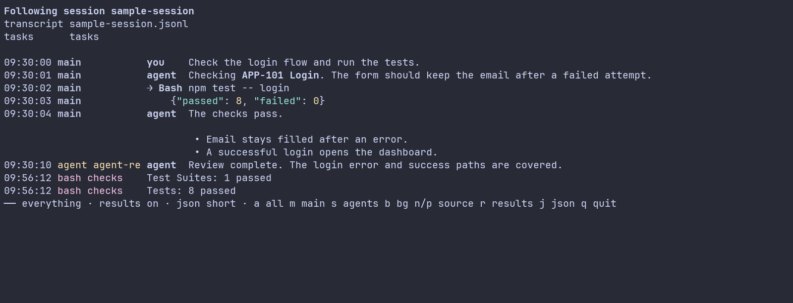
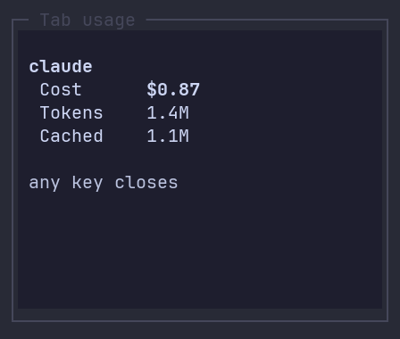
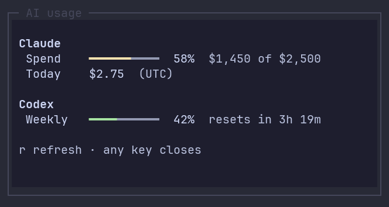
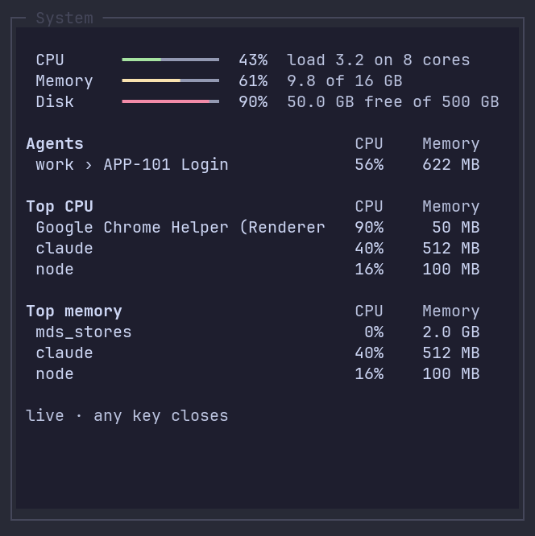

# tmux reference

[Back to README](../README.md)

Images show the running terminal interfaces with sample task names and values. See
[capture notes](images/README.md) for the source of each view.

## Conversation logs

`prefix e` opens logs beside the current agent and leaves focus on the agent.
Press it again from either pane to close the logs. `prefix W` opens a tmux
window; `prefix C-e` opens a Ghostty window through AppleScript. Press `q` in
the viewer to close it. The agent-skills `/logs` command offers the same choices.

The source labels distinguish the main conversation, subagents, and background
commands. Tool results and formatted JSON appear alongside the messages.



| Key in the viewer | Action |
| --- | --- |
| `a` | Show all sources |
| `m` | Show the main conversation |
| `s` | Show subagents |
| `b` | Show background commands |
| `n` / `p` | Select the next / previous source |
| `r` | Toggle tool results |
| `j` | Toggle full / shortened JSON |
| `q` | Close the viewer |

Claude and Codex support main conversation logs. Claude also supports subagent
transcripts and background command output. opencode logs are not supported by
this viewer.

The viewer renders Markdown, clickable links and file paths, and formatted JSON
or Python dictionaries and lists. Tool results initially show up to 12 lines;
background JSON shows up to 24. New sources appear as they start.

To follow a known conversation outside tmux:

```sh
tmux-agent-logs follow <session-id>
```

`uv` installs the viewer's `rich` dependency on first use. If links are not
clickable after a config reload, reattach the tmux client so the `hyperlinks`
terminal feature takes effect.

## Usage displays

| Shortcut | Display |
| --- | --- |
| `prefix T` | Tokens and cost for agents in the current tab |
| `prefix v` | Account limits or spend for Claude and Codex |
| `prefix S` | System usage and the busiest agent process trees |

### Tab tokens and cost

`prefix T` groups usage by agent in the current tab, including cached tokens and
the Codex usage limit when available.



Claude's tab cost comes from its status-line payload. Codex's tab cost is an
estimate at configured API prices, marked `~`; it is not the ChatGPT subscription
bill. Unknown Codex models show tokens without a cost. Token totals include
cached input, and Claude totals include subagents.

Setup adds Claude's status line only when none is configured. If you keep your
own status line, it must call [tmux-claude-statusline](../bin/tmux-claude-statusline)
for Claude's tab usage to update.

### Account usage

`prefix v` shows usage across each account. This example shows Claude's monthly
spend and today's spend in UTC, followed by Codex's weekly usage and reset time.
All amounts and percentages are sample values.



The account popup uses the agents' existing logins and caches responses for a
minute. Press `r` to refresh. On failure, it retains the last values with their
age. Claude shows plan limits or monthly spend, depending on the account;
Codex shows its plan usage windows.

### System usage

`prefix S` shows machine usage, totals for agent process trees, and the processes
using the most CPU and memory.



The system popup refreshes every few seconds. CPU per process is measured
against one core, so a process can exceed 100%. Memory includes app, wired, and
compressed pages. Disk usage is based on APFS container capacity and free space;
Finder can show more available space because it includes purgeable files.

### Connect Claude daily spend

Enterprise daily spend needs a Claude web session in addition to the CLI login.
In your signed-in browser, copy the `sessionKey` cookie for `https://claude.ai`
from Developer Tools. Run this in your own terminal and paste it at the hidden
prompt:

```sh
tmux-ai-usage --connect-claude
```

Use the same account as the Claude Code login. The helper stores the web session
in macOS Keychain under `tmux-ai-usage-claude-web`. Open `prefix v` and press `r`
to fetch it. Reconnect when the web session expires.

Daily spend uses UTC dates and can lag behind current activity. Yesterday's
cached value is not shown as today's spend.

## Hooks and registry integration

[tmux-agent-status](../bin/tmux-agent-status) forwards session events to
agent-skills' `runs session` command. It caches identity and activity on the pane
for tab colors and layout restore. A valid session ID is recorded outside tmux
too. If `runs` is missing or fails, pane status still updates.

The registry normally lives at `~/.local/share/agent-sessions/sessions.sqlite3`.
Its storage options and migration rules belong to the
[agent-skills documentation](https://github.com/osvald0/agent-skills).
`TMUX_AGENT_RUNS` overrides the executable used by the hook, mainly for testing.

| Agent | Source | Installed location |
| --- | --- | --- |
| Claude Code | [hooks.json](../agents/claude/hooks.json) | `~/.claude/settings.json` |
| Codex | [hooks.json](../agents/codex/hooks.json) | `~/.codex/hooks.json` |
| opencode | [plugin](../agents/opencode/tmux-agent-status.js) | `~/.config/opencode/plugins` |

The JSON files and plugin define the event mappings. Hooks supply the activity
and provider as arguments, with session metadata on stdin. Exit events clear
only matching identities. opencode also uses a process owner to protect a
replacement session from a late exit.

Codex hooks run in a shared daemon, so its inherited pane can belong to another
session. The helper uses an existing session match, or a single unclaimed Codex
pane in the same directory. Ambiguous matches remain unbound instead of changing
an unrelated pane; their registered conversations remain available in `runs --all`.

## Notifications

Claude and opencode notify on waiting, completion, or error. Notifications are
skipped when the pane is already focused, and for Claude's idle notification
immediately after completion. Codex sends its own notifications.

The helper writes terminal notification sequences to the tmux client's terminal.
Ghostty displays these as macOS notifications while Ghostty is not focused.
Shift+Enter and modified keys are enabled through tmux's extended-key support.

## Restore troubleshooting

| Symptom | Check |
| --- | --- |
| No recent automatic layout save | Continuum skips autosaving while another tmux server is running. Check for leftover test servers or a separate `TMUX_TMPDIR`. |
| A restored pane resumes the wrong conversation | The saved pane may have had no session ID. Submit a prompt in the agent, then save the layout again. |
| A conversation is missing from the picker | Look in `runs --all`; closed or unbound conversations are hidden from the normal list. |
| The picker command is missing | Install agent-skills' global tools and confirm `~/.local/bin/runs` exists. |
| Logs do not open | Rerun `./setup.sh` from the checkout and confirm `uv` is installed. |

With an ID, restore uses `claude --resume <id>`, `codex resume <id>`, or
`opencode --session <id>`. Without one, it falls back to each tool's latest-session
continuation command. The registry keeps conversation metadata independently of
these layout snapshots.

## Checks

Run the shell suite from the repository:

```sh
bash -c 'for check in tests/*.sh; do bash "$check" || exit; done'
```

Run the hook and opencode integration checks:

```sh
python3 tests/agent-status.py && node --experimental-vm-modules tests/opencode-status.mjs
```

The Node test uses built-in module mocks and may print an experimental-module
warning. For the cross-project flow, pass the path to the matching agent-skills
checkout:

```sh
python3 tests/registry-integration.py /absolute/path/to/agent-skills/global/bin/runs
```

This test uses a temporary tmux server and explicit temporary database paths. It
checks registration, waiting indicators, disconnection, all-provider resume, and
legacy import preservation, then removes its server and fixtures.
